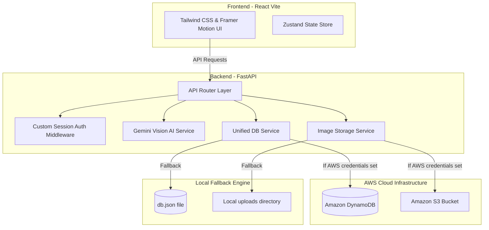
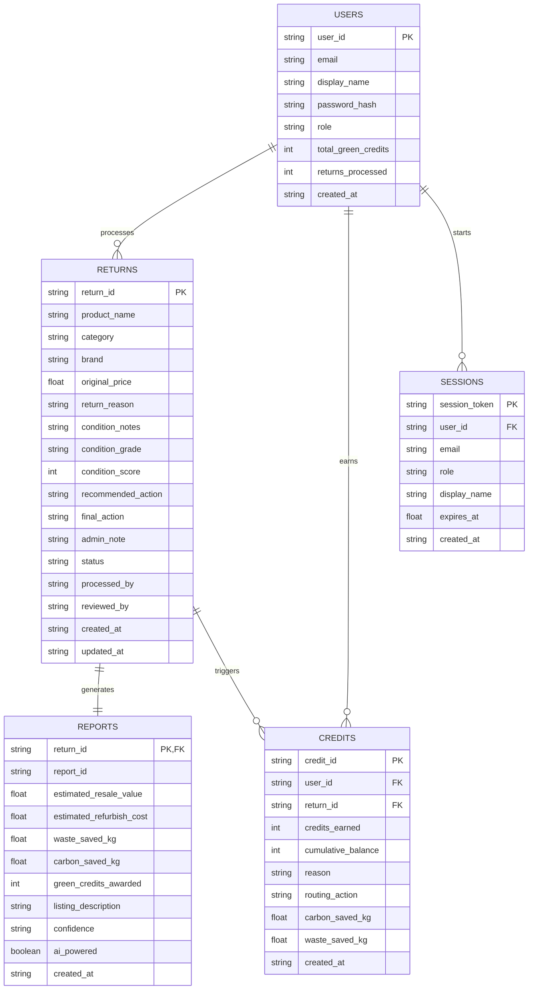

# ReturnWise AI 📦♻️
### Intelligent Return Routing & Second-Life Commerce Decision System
**Built for the Second Life Commerce Track — Amazon HackOn 2026**

---

## 🚀 Project Overview

**ReturnWise AI** is a decision intelligence platform designed to transform e-commerce product returns from operational losses into circular commerce opportunities. Instead of routing returns blindly to liquidation or disposal, ReturnWise AI uses **Google Gemini Vision** multimodal analysis combined with structured warehouse assessments to determine the optimal circular path for each item. 

The platform supports five core circular routes:
1. **Restock:** Re-insert into original inventory (Grade A - Like New, packaging intact).
2. **Resell:** List on the refurbished second-life marketplace (Grade A/B - Good/Like New).
3. **Refurbish:** Send for professional repair (Grade B/C - fixable issues).
4. **Donate:** Donate to charities to maximize social impact and tax write-offs (low value, functional).
5. **Recycle:** Responsible material recovery (Grade D - beyond economical repair).

---

## 🏛️ System Architecture

ReturnWise AI is built using a modern, scalable, and robust architecture leveraging **React (Vite)** on the frontend, **FastAPI** on the backend, and **Amazon Web Services (AWS)** for database and image storage. 

To enable seamless review and grading by hackathon judges, the system features a **Hybrid Engine** that runs offline in **Local Mode** by default and automatically promotes to **AWS Mode** when cloud credentials are configured.



### Key Technical Integration Highlights
* **AWS S3 Integration:** Images uploaded by warehouse operators are securely sent to Amazon S3 (or stored locally under `backend/static/uploads/`). Uploads are routed through the backend to keep credentials hidden from the client browser.
* **AWS DynamoDB Integration:** Return records, reports, session tokens, and green credit logs are managed in DynamoDB tables. Tables are **automatically provisioned** on backend startup if they do not already exist in the AWS account.
* **Google Gemini AI Integration:** Product photos are downloaded and processed by `gemini-1.5-flash` to evaluate damage, estimate condition scores, recommend routing, and draft compelling second-life marketplace descriptions.

---

## 📊 Database Design (ER Diagram)

The system manages the schema natively across both DynamoDB and the Local JSON fallback using the following relational structure:



---

## ⚡ Setup & Installation

### Prerequisites
* Python 3.11+
* Node.js v18+

### Step 1: Clone and Configure Environment

1. Copy backend environment variables:
   ```bash
   cd backend
   cp .env.example .env
   ```
2. Configure your backend `.env` variables:
   * **`GEMINI_API_KEY`**: Obtain a free key from [Google AI Studio](https://aistudio.google.com/).
   * **AWS Mode (Optional):** Add your `AWS_ACCESS_KEY_ID`, `AWS_SECRET_ACCESS_KEY`, and `AWS_S3_BUCKET` to connect to DynamoDB and S3. **If left blank, the app will run locally on `db.json` automatically.**

3. Copy and configure frontend environment variables:
   ```bash
   cd ../frontend
   cp .env.example .env
   ```

---

### Step 2: Start the Backend Server

1. Set up a Python virtual environment:
   ```bash
   cd backend
   py -3.11 -m venv venv
   venv\Scripts\activate
   ```
2. Install dependencies:
   ```bash
   pip install -r requirements.txt
   ```
3. Run the development server:
   ```bash
   uvicorn app.main:app --reload
   ```
   The API will be available at `http://localhost:8000` and docs at `http://localhost:8000/docs`.

---

### Step 3: Start the Frontend Application

1. Install dependencies:
   ```bash
   cd frontend
   npm install
   ```
2. Run the development server:
   ```bash
   npm run dev
   ```
   Open your browser and navigate to `http://localhost:5173`.

---

## 🔑 Quick Demo Access

You can log in instantly using the pre-configured demo roles shown on the Login Page:

| Role | Email | Password | Access Rights |
|---|---|---|---|
| **Warehouse Operator** | `operator@demo.com` | `Demo@123` | Return registration, uploads, and AI analysis intake. |
| **Admin Reviewer** | `admin@demo.com` | `Demo@123` | Overriding/Approving decisions, reviewing detailed audits. |
| **Ops Manager** | `manager@demo.com` | `Demo@123` | Visual analytics dashboards and green credit tracking. |
